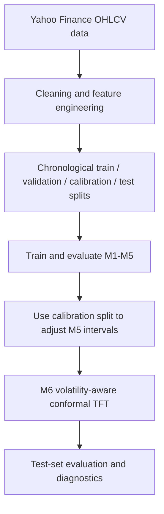

# Probabilistic Financial Forecasting with Uncertainty Quantification

A multi-asset financial time-series project that forecasts **future realized volatility as a probability distribution**, rather than producing only a single point estimate. The goal is to study not just how accurate a forecast is, but also how reliable its uncertainty intervals are.

The notebook builds a leakage-conscious data pipeline, compares statistical and neural forecasting models, applies volatility-aware conformal calibration, and evaluates the resulting forecasts using calibration and sharpness diagnostics.

---

## Project Overview

Financial markets are noisy and volatility changes over time. A point forecast can hide the range of outcomes that a risk manager or analyst should consider. This project therefore predicts multiple quantiles of future volatility and constructs an **80% prediction interval** from the 10th and 90th percentiles.

The experiments use daily market data for four assets:

| Asset | Yahoo Finance ticker | Asset class |
|---|---|---|
| NIFTY 50 | `^NSEI` | Equity index |
| SPY | `SPY` | Equity ETF |
| USD/INR | `INR=X` | Foreign exchange |
| EUR/USD | `EURUSD=X` | Foreign exchange |

The notebook requests data from **1 January 2007 up to (but not including) 1 November 2026**. The available history can vary by asset and may change when the data is downloaded again.

## Workflow



## Problem Formulation

The forecasting target is the **log of 21-trading-day annualized realized volatility**. Realized volatility is estimated from daily OHLC prices using the Garman–Klass range-based estimator.

For a trading day, the Garman–Klass variance estimate is:

\[
GK_t = \frac{1}{2}\left(\ln\frac{H_t}{L_t}\right)^2
- (2\ln 2 - 1)\left(\ln\frac{C_t}{O_t}\right)^2
\]

The 21-day annualized realized volatility is computed by taking the rolling mean of daily variance estimates and annualizing it using 252 trading days. When the range-based estimate is missing or non-positive, the implementation falls back to squared close-to-close log returns.

The final modelling target is:

\[
y_t = \log(RV_{21,t} + \epsilon), \qquad \epsilon = 10^{-8}
\]

Each model produces the quantiles:

\[
q \in \{0.1, 0.2, \ldots, 0.9\}
\]

for forecast horizons of **1 to 5 trading days**. The central 80% prediction interval is therefore:

\[
[ q_{0.1},\ q_{0.9} ]
\]

## Methodology

### 1. Data preparation and feature engineering

The notebook downloads OHLCV data with `yfinance`, cleans invalid or missing closing-price observations, and creates a combined panel for the four assets.

Features include:

- Daily log returns, absolute returns, and squared returns.
- Short- and longer-window rolling volatility features (5-day and 63-day).
- The ratio of short-term to 21-day realized volatility.
- GARCH(1,1) conditional volatility and its logarithm.
- Calendar features such as day of week, month, day of month, and a turn-of-month indicator.
- Static asset identifiers and asset-class labels.

Volatility regimes (`low`, `medium`, and `high`) are assigned using the 33rd and 67th percentiles of the **training-period** realized volatility distribution.

### 2. Chronological data splits

The project uses time-based splits instead of random shuffling:

| Split | Date range | Purpose |
|---|---|---|
| Train | Up to 31 Dec 2020 | Fit model parameters and training-only preprocessing |
| Validation | 1 Jan 2021 – 31 Dec 2022 | Model selection, early stopping, and tuning |
| Calibration | 1 Jan 2023 – 31 Oct 2024 | Conformal interval calibration |
| Test | From 1 Nov 2024 onward | Final out-of-sample evaluation |

GARCH parameters are fitted using training-period observations and then used to generate forward conditional-volatility features. The volatility-regime thresholds are also calculated from training data only. Evaluation windows retain historical encoder context while keeping their forecast targets inside the relevant validation, calibration, or test period.

### 3. Forecasting models

Six model variants are compared:

| ID | Model | Description |
|---|---|---|
| M1 | Persistence | Uses the most recently observed realized-volatility target as a simple baseline, with forecast-error scale estimated from training data. |
| M2 | GARCH(1,1) | Classical volatility-model baseline with Student-t innovations. |
| M3 | DeepAR | Autoregressive recurrent model trained with a normal distribution loss. Monte Carlo forecast samples are used to estimate the requested quantiles. |
| M4 | Standard TFT | Temporal Fusion Transformer trained with quantile loss, without the additional GARCH features. |
| M5 | GARCH-TFT | Temporal Fusion Transformer augmented with GARCH conditional-volatility features. |
| M6 | Volatility-aware conformal TFT | Post-processes the M5 prediction intervals using calibration-period errors scaled by volatility at the forecast origin. This is a calibrated version of M5, not a separately trained neural network. |

The neural forecasting models use a **60-trading-day encoder window** and predict the next **5 trading days**. TFT models predict the nine quantiles directly using quantile loss. DeepAR generates 200 forecast samples per evaluation window and derives quantiles from those samples.

### 4. Volatility-aware conformal calibration

M6 starts with the GARCH-TFT (M5) prediction intervals. On the separate calibration split, it measures how far observations fall outside the nominal 80% interval and normalizes those errors using GARCH volatility at the forecast origin. An empirical 80th-percentile calibration threshold is then used to expand or contract the M5 interval according to the volatility at each forecast origin.

This step is intended to improve interval coverage while allowing interval width to respond to changing volatility. It does not guarantee that the resulting intervals will achieve exactly 80% coverage on a future test period; that must be checked empirically.

### 5. Evaluation

The notebook evaluates forecasts using several complementary measures:

- **Pinball loss:** measures quantile-forecast accuracy; lower is better.
- **80% coverage:** fraction of actual observations falling between the 10th and 90th percentile forecasts. A value close to 0.80 is the nominal target.
- **Sharpness / interval width:** average width of the 80% interval. Narrower intervals are preferable only when coverage remains adequate.
- **Interval score:** rewards narrow intervals while penalizing observations that fall outside them; lower is better.
- **Probability Integral Transform (PIT) histograms:** diagnostic for distributional calibration; a roughly uniform histogram is a useful sign of calibration.

The notebook also breaks down interval coverage by volatility regime and forecast horizon, and generates sharpness, PIT, fan-chart, and TFT variable-importance visualizations.

---

## Test Results

The following table is copied from the executed notebook's pooled test-set evaluation. The metrics are aggregated across the four assets and forecast horizons.

| Model | Pinball loss (notebook label: CRPS) ↓ | 80% coverage | 80% interval width ↓ | Interval score ↓ |
|---|---:|---:|---:|---:|
| M3 – DeepAR | **0.0327** | 0.7630 | 0.1877 | **0.4388** |
| M1 – Persistence | **0.0304** | 0.9049 | 0.2641 | 0.4528 |
| M4 – Standard TFT | 0.0312 | 0.7784 | 0.1646 | 0.4620 |
| M5 – GARCH-TFT | 0.0359 | 0.6559 | **0.1633** | 0.5327 |
| M6 – Volatility-aware conformal TFT | 0.0365 | 0.8909 | 0.3377 | 0.5850 |
| M2 – GARCH(1,1) | 0.1237 | 0.8979 | 1.2620 | 1.6611 |

**How to read these results:**

- DeepAR has the lowest interval score in this run, but its 80% interval covers 76.3% of test observations, below the nominal 80% level.
- Persistence has the lowest reported pinball loss and achieves 90.5% coverage, although its intervals are wider than those of the neural models.
- Standard TFT and GARCH-TFT produce relatively narrow intervals, but their observed coverage is below the 80% target. GARCH-TFT has particularly low coverage in this run.
- Conformal calibration increases GARCH-TFT coverage from 65.6% to 89.1%, but also more than doubles its average interval width (from 0.1633 to 0.3377). Its interval score is higher than the uncalibrated M5 score in this test run.
- The standalone GARCH baseline produces much wider intervals and the highest interval score in this comparison.

There is no single winner across all metrics. The results illustrate the trade-off between forecast accuracy, interval coverage, and sharpness. In particular, a narrow interval should not be treated as better when it misses too many actual observations.

> **Note:** The values above are the results stored in the current notebook execution. Re-downloading Yahoo Finance data, changing package versions, or retraining the neural models can lead to different results. Interval widths are measured on the log-realized-volatility target scale.

---

## Repository Structure

The repository contains the following top-level items:

```text
.
├── data/                  # Financial data and processed data files
├── researchpapers/        # Supporting research material
├── results/               # Saved project results
├── project.ipynb          # Main end-to-end implementation and experiments
├── problem_statement.pdf  # Project problem statement
├── requirements.txt       # Python dependencies
└── README.md
```

When the notebook is run, it also creates an `artifacts/` directory for generated outputs. This includes:

```text
artifacts/
├── preds_M1_Persistence.parquet
├── preds_M2_GARCH.parquet
├── preds_M3_DeepAR.parquet
├── preds_M4_TFT_Base.parquet
├── preds_M5_TFT_GARCH.parquet
├── preds_M6_VA_C_TFT.parquet
└── figures/
    ├── fig1_sharpness_diagram.png
    └── fig2_pit_histograms.png
```

Model checkpoints and additional generated figures are also stored under `artifacts/` by the notebook.

## Getting Started

### Requirements

- Python 3.10 or newer is recommended.
- The packages listed in [`requirements.txt`](requirements.txt).
- An internet connection for downloading market data from Yahoo Finance.
- A CUDA-capable GPU is recommended for faster neural-model training. The notebook selects an available accelerator automatically and can fall back to CPU.

### 1. Clone the repository

```bash
git clone https://github.com/akshayvarala/Probabilistic-Financial-Forecasting-with-Uncertainty-Quan-tification.git
cd Probabilistic-Financial-Forecasting-with-Uncertainty-Quan-tification
```

### 2. Create and activate a virtual environment

**Windows (PowerShell):**

```powershell
python -m venv .venv
.venv\Scripts\Activate.ps1
```

**macOS / Linux:**

```bash
python -m venv .venv
source .venv/bin/activate
```

### 3. Install dependencies

```bash
python -m pip install --upgrade pip
pip install -r requirements.txt
```

The requirements file includes `ipykernel`, but does not install a Jupyter notebook server. You can open `project.ipynb` in VS Code with the Python and Jupyter extensions, or install JupyterLab separately:

```bash
pip install jupyterlab
jupyter lab
```

### 4. Run the notebook

Open `project.ipynb` and execute the cells **from top to bottom** with the repository root as the working directory.

The notebook runs the workflow in sequence:

1. Downloads the four asset histories and builds the processed volatility panel.
2. Fits the statistical and neural forecasting models and saves their predictions.
3. Calibrates the GARCH-TFT intervals using the calibration split.
4. Evaluates all models on the held-out test split and generates diagnostic plots.

The first phase writes `data/financial_vol_panel.parquet` and `data/financial_vol_panel.csv`. Later phases write prediction files, checkpoints, and figures under `artifacts/`.

## Reproducibility Notes

- The notebook sets the PyTorch Lightning seed to `42`.
- The date boundaries and forecast configuration are defined near the beginning of `project.ipynb` and can be changed there.
- Run cells in order. Later phases depend on the data panel and prediction files produced by earlier phases.
- Keep the repository root as the notebook working directory because input and output paths are relative.
- Yahoo Finance data is updated over time, so a fresh run may not reproduce the exact row counts or metrics shown above.
- Neural-model training can take time, particularly on CPU. The notebook uses early stopping and model checkpoints for TFT training.

## Limitations

- The experiments focus on daily realized-volatility forecasting for four selected assets; they do not cover every market, asset class, or sampling frequency.
- The target is realized volatility, not future price, return direction, or portfolio performance.
- Empirical interval coverage can change across assets, forecast horizons, and volatility regimes. Aggregate coverage alone may hide these differences, which is why the notebook also includes regime- and horizon-level diagnostics.
- Conformal calibration can widen intervals substantially. Better coverage does not automatically imply a better interval score or a more useful forecast.
- Results depend on the downloaded data, the selected date splits, and the training environment.

## Disclaimer

This project is intended for educational and research purposes. Forecasts and prediction intervals are experimental outputs, not investment recommendations or financial advice. The project does not demonstrate a profitable trading strategy, and no guarantee is made about the accuracy or reliability of forecasts in live markets.
